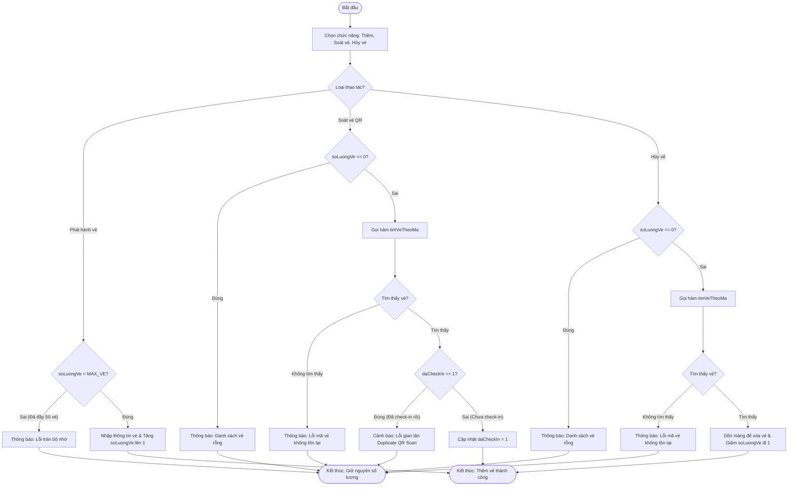

# BÁO CÁO PHÂN TÍCH THIẾT KẾ KIẾN TRÚC MODULE HÀM CRUD HOÀN CHỈNH CHO TICKETBOX

> 👤 **Học viên:** Hoàng Công Dũng | **Mã SV:** PTIT-HCM-009
> 🏫 **Môn học:** it102-rl-hoangcongdung

---

## 📊 Sơ đồ thiết kế hệ thống (Activity Diagram)

> 💡 *Sơ đồ dưới đây được render tự động trực tiếp trên GitHub bằng Mermaid. Bạn cũng có thể tải file **`bt2.drawio`** trong repository này để mở và chỉnh sửa trực tiếp trên [Draw.io (diagrams.net)](https://app.diagrams.net).* 

---

## Nhiệm vụ 1: Phân tích I/O và Thiết kế Kiến trúc Hàm

Mình đã phân tích kỹ lưỡng các yêu cầu nghiệp vụ của Ban tổ chức đại nhạc hội 'Live Concert VIBE 2025' để xây dựng danh sách tham số đầu vào (Input) và đầu ra (Output) cho từng hàm xử lý trong Module quản lý vé.

Việc phân tách rõ ràng trách nhiệm theo nguyên tắc SRP giúp mã nguồn dễ bảo trì, dễ mở rộng và kiểm thử độc lập.

- Hàm timVeTheoMa(struct VeSuKien ds[], int soLuong, int maCanTim): Input là mảng cấu trúc vé, tổng số lượng hiện tại và mã vé cần tìm. Output trả về chỉ số (index từ 0 đến soLuong - 1) nếu tìm thấy, hoặc trả về -1 nếu không tồn tại. Hàm này đóng vai trò hạt nhân, được tái sử dụng triệt để cho cả chức năng Soát vé và Hủy vé.
- Hàm tinhGiaThanhToan(struct VeSuKien v): Input là một cấu trúc vé v. Output trả về số tiền thực tế sau khi đã áp dụng chính sách ưu đãi Early Bird (giảm 15% nếu isEarlyBird == 1, ngược lại giữ nguyên giaGoc).
- Hàm phatHanhVe(struct VeSuKien ds[], int *soLuong, struct VeSuKien veMoi): Input là mảng vé, con trỏ số lượng vé và vé mới cần thêm. Output trả về 1 nếu thêm thành công, trả về 0 nếu mảng đã đầy (tràn bộ số lượng MAX_VE = 50).
- Hàm soatVeQR(struct VeSuKien ds[], int soLuong, int maVe): Input là mảng vé, tổng số lượng và mã vé quét cổng. Output trả về 1 nếu check-in thành công, 0 nếu vé không tồn tại hoặc đã check-in trước đó (chặn lỗi Duplicate QR Scan).
- Hàm huyVe(struct VeSuKien ds[], int *soLuong, int maVe): Input là mảng vé, con trỏ số lượng và mã vé cần hủy. Output trả về 1 nếu hủy thành công kèm giải thuật dồn mảng, 0 nếu không tìm thấy vé.

## Nhiệm vụ 2: Xử lý Edge Cases và Quy tắc Nghiệp vụ Dị biệt

Để hệ thống vận hành trơn tru tại cổng tự động trong ngày diễn ra sự kiện, mình đã chủ động lập trình các cơ chế phòng thủ chặt chẽ nhằm xử lý triệt để 4 lỗi thường gặp:

Thứ nhất là lỗi Trùng lặp mã QR (Duplicate QR Scan): Khi khán giả cố gắng quét lại mã vé đã qua cổng (daCheckIn == 1), hệ thống lập tức phát hiện trạng thái, từ chối mở cửa xoay và hiển thị cảnh báo gian lận mà không làm thay đổi dữ liệu.

Thứ hai là lỗi Mã vé không tồn tại: Hàm tìm kiếm hạt nhân timVeTheoMa trả về giá trị -1 giúp hệ thống nhận biết ngay lập tức để thông báo lỗi cho người dùng khi thao tác với một mã vé bất kỳ không có trong cơ sở dữ liệu.

Thứ ba là lỗi Tràn bộ nhớ (Overflow): Trước khi thực hiện phát hành vé mới, hệ thống kiểm tra điều kiện soLuongVe < MAX_VE. Nếu danh sách đã đạt tối đa 50 vé, thao tác thêm bị từ chối an toàn.

Thứ tư là lỗi Thao tác mảng rỗng (Underflow): Kiểm tra kỹ lưỡng danh sách vé hiện tại có bằng 0 hay không trước khi thực hiện các tác vụ soát vé hoặc hủy vé.

- Đảm bảo an toàn bộ nhớ mảng tĩnh và con trỏ truyền tham chiếu để đồng bộ số lượng vé ngoài hàm main.
- Tuân thủ nghiêm ngặt chuẩn định dạng mã nguồn C, biên dịch sạch sẽ không cảnh báo với cờ -Wall.

## Nhiệm vụ 3: Mã nguồn hoàn chỉnh (main.c)

Dưới đây là toàn bộ mã nguồn chương trình C được viết hoàn chỉnh, có gắn kèm khối kiểm thử (Demo) chạy qua tất cả các kịch bản edge cases theo đúng yêu cầu bài tập.

---

## 📁 Danh sách tệp tin nộp bài trong Repository
- 📝 `bt2.docx`: Báo cáo tài liệu phân tích nghiệp vụ hoàn chỉnh.
- 🎨 `bt2.drawio`: File thiết kế sơ đồ chuẩn theo quy định đề bài (mở trực tiếp bằng [Draw.io](https://app.diagrams.net) hoặc Lucidchart).
- 💻 `main.c`: Mã nguồn chương trình.
